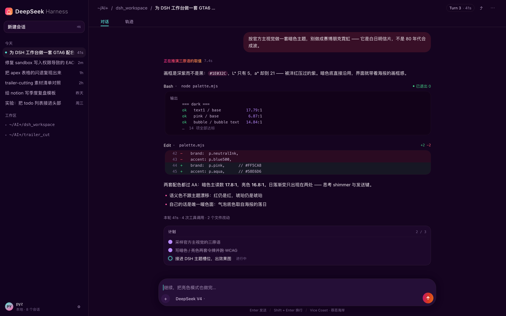
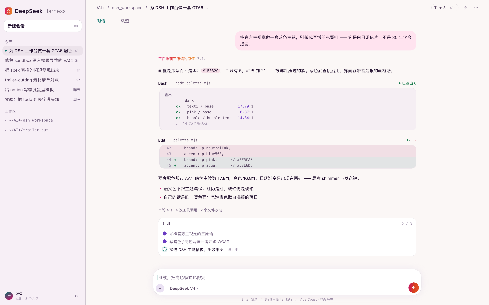
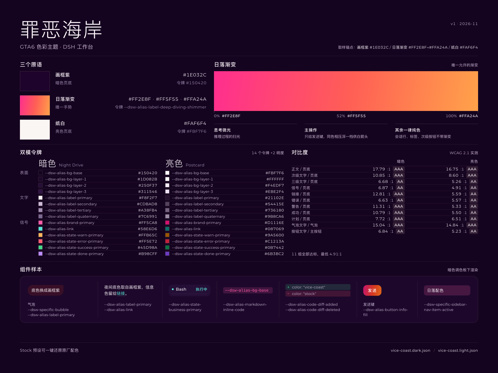
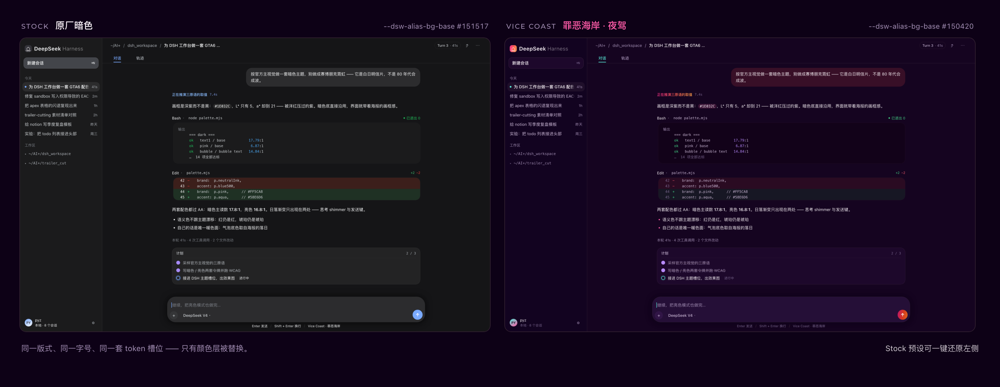

# Vice Coast

[简体中文](README.md) · **English**

> A sunset palette theme for the [DeepSeek Harness](https://github.com/deepseek-ai) (DSH) workbench, sampled from the GTA VI key art: **frame violet, a magenta→orange sunset sweep, and warm paper**.

Dark is **Night Drive** (violet night surfaces, magenta signal). Light is **Postcard** (warm paper, pastel violet panels). Nothing changes but colour — no new typefaces, no size or spacing changes, no new radii.





| | |
| --- | --- |
| What it touches | the theme token layer (148 tokens × 2 schemes), one motion curve, the brand mark seat |
| Leaves alone | typefaces, font sizes, spacing, radii, every host component's internals |
| Light / dark | follows DSH's own Appearance setting: dark = Night Drive, light = Postcard |
| Semantics | error, warning, success and plan colours never move with the palette |
| Contrast | 17 key pairs measured, all passing (body-level ≥ 4.58:1, comment-level ≥ 3.60:1) |
| Licence | MIT |





## Install

This needs a DSH Web profile (launched as `dsh --profile web` or equivalent).

```bash
git clone https://github.com/panyz/dsh-vice-coast-theme
cd dsh-vice-coast-theme

# optional: rebuild with your own mark (see below); skip it to use the committed build
node tools/build-plugin.mjs
```

Then install the `plugin/` directory as a local bundle:

- In the app: **Settings → Plugins**, use "install from a local directory" and pick this repo's `plugin/` folder.
- Or let an agent call `plugin_manager`: action `install_bundle`, with `target` set to the absolute path of `plugin/`.

**Restart Harness once** after installing — an installed package's browser module is loaded at runtime, so a page refresh may not pick up a new one. Then open **Settings → General → Vice Coast theme**:

- `Vice Coast` / `Stock` — Stock removes the whole override layer and the UI returns to the shipped palette immediately, without touching any file.
- There is no dark/light switch here; that follows DSH's Appearance setting.

To uninstall, disable or remove the bundle on the Plugins page. Every trace of the palette leaves with the override layer.

## Use your own mark

The theme puts a **sunset plate + mark image** in the sidebar's brand seat. The default is original artwork (a sunset disc over a horizon line). To use your own avatar instead:

```bash
# 1) matte: turn a flat background into a real alpha channel
#    (it keys out sky blue #5ABEFB by default)
bash assets/matte.sh /path/to/your-avatar-128.png   # writes assets/logo-cut.png

# 2) rebuild: inline the matted image into the browser module
node tools/build-plugin.mjs --logo assets/logo-cut.png
```

- Use a square PNG from 128 to 512 px; a flat background and a centred subject work best.
- The plate is a CSS gradient, so the image needs no background of its own. Bottom-anchoring and the 4% inset are already handled.
- To keep the default mark, change nothing — the committed `plugin/client.js` already carries it.
- `assets/logo-cut.png` is git-ignored: don't commit your own avatar.

## Change the colours

All colour lives in one place: [`palette.mjs`](palette.mjs). After editing:

```bash
node palette.mjs            # WCAG self-check: prints every key pair's ratio
node tools/build-plugin.mjs # regenerate plugin/client.js
node verify/smoke.mjs       # run the module contract against a stubbed page (no browser)
```

`palette.mjs` holds a small set of primitives (a `dark` and a `light` block); every other token is derived from them. To retint the theme, change `pink` (the signal) and `aqua` (interaction) — code highlighting, diffs, caret and selection follow automatically.

## Reproducing the images

```bash
node tools/render-all.mjs                          # 01 / 02 / 04 plus the stock reference
node tools/shot.mjs mockups/app.html mockups/out.png 1600 1000 2   # any size
node tools/gen-mark-sheet.mjs && node tools/shot.mjs mockups/mark-sheet.html mockups/05-mark.png 1600 380 2
```

The images are not screenshots. Each one is a static page built from the **same `var(--dsw-alias-*)` tokens**, using the host's measured geometry (sidebar 280, content column 845, title row 76, 28px composer radius), rendered with headless Chrome. What differs from the real app is font rasterisation, nothing else.

## Compatibility and known limits

- Developed and verified on the DSH Web profile (2026-11 build). It needs the Client `slots` / `theme` / `locale` services and the `theme.overrideTokens` override layer.
- The first paint colour is pre-painted by the host (`#151517` / `#fff`) before the theme layer exists — expect one brief grey flash at startup.
- A few colours are hardcoded in the host and cannot be reached from the token layer: the send glyph is white (which is why the button-grade gradient is deepened to clear 3:1), the model selector chevron is `#81858C`, and the context meter is `#a78bfa`.
- On macOS the desktop shell lays a blue vibrancy gradient over the sidebar, so it reads slightly bluer than on Windows.
- Safari's `corner-shape: superellipse()` makes corners rounder than in Chrome.

Design notes — sampling evidence, component mapping, the full token table, and what was deliberately cut — are in [DESIGN.md](DESIGN.md). That document is written in Chinese; its tables and figures stand on their own.

## Layout

```
README.md / README.en.md  docs (Chinese / English)
LICENSE                  MIT
palette.mjs               colour truth + WCAG self-check
plugin/                   the installable bundle (package.json / patch / client.js / locale / icon)
design/client.template.js browser module source (palette, copy and mark are injected at build)
tools/                    build, screenshots, geometry probe, doc tables, release guard
verify/smoke.mjs          module contract test (no browser)
mockups/                  the effect images and the static pages behind them
assets/                   mark artwork and the matte script
docs/                     measured notes on the host's structure and tokens
```

## Disclaimer and licence

- **Unofficial.** This project is not affiliated with, endorsed by, or sponsored by Rockstar Games, Take-Two Interactive, or DeepSeek.
- The palette was **sampled from public promotional art and then tuned by hand**. The repository contains **no** official artwork, logos or screenshots.
- "Grand Theft Auto", "GTA" and related names are trademarks of their owners, referenced here only to describe provenance.
- Code is licensed under [MIT](LICENSE); the bundled mark artwork (`assets/logo-default.svg`) is released under the same licence.
- Montserrat, used in the effect images, is distributed under the SIL Open Font License 1.1 — see [`mockups/fonts/Montserrat-OFL.txt`](mockups/fonts/Montserrat-OFL.txt).
