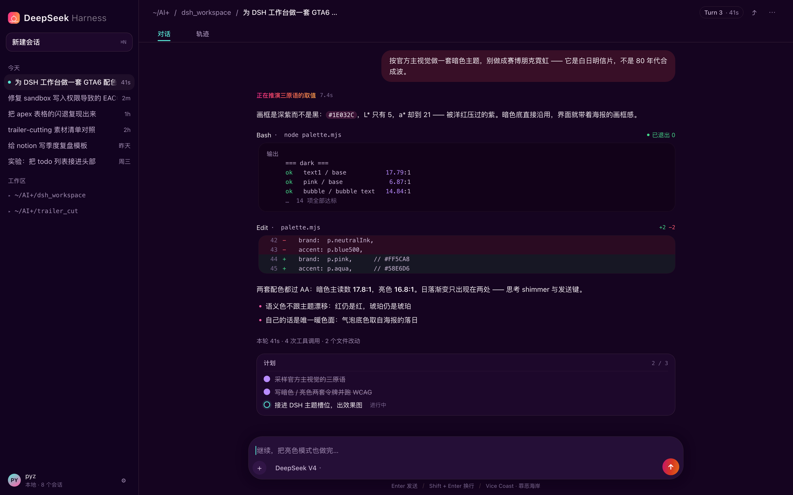
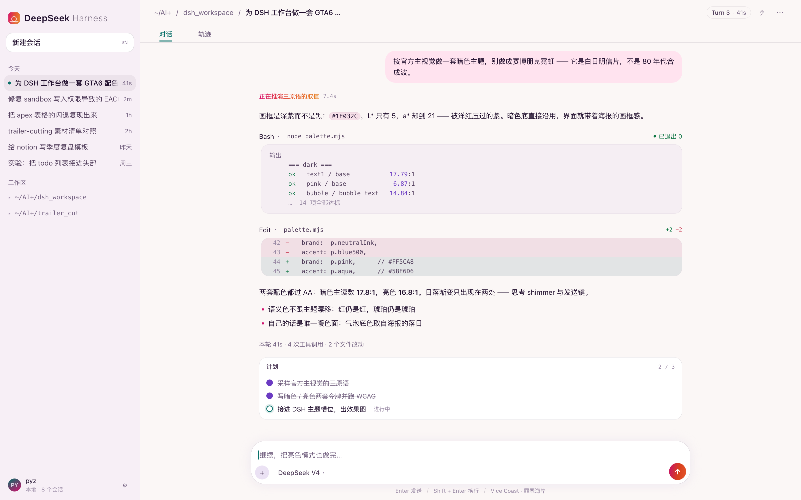
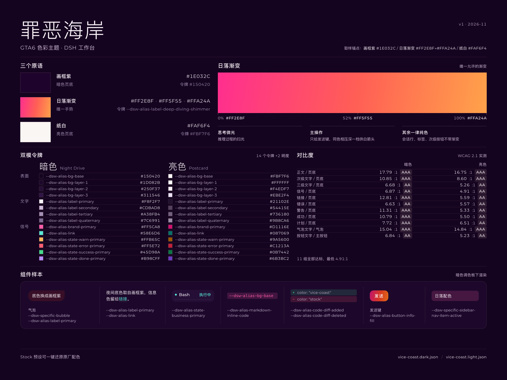
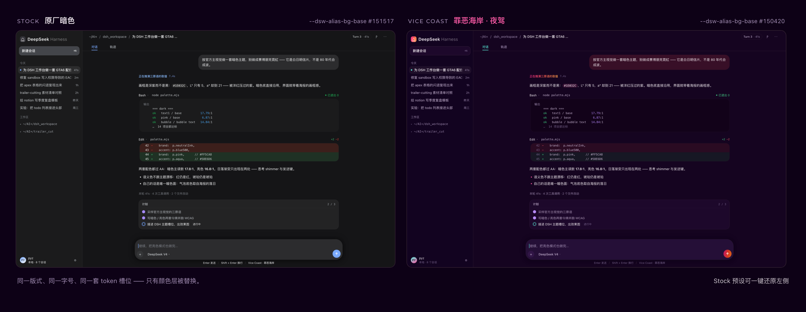

# 罪恶海岸 · Vice Coast

**简体中文** · [English](README.en.md)

> 一套给 [DeepSeek Harness](https://github.com/deepseek-ai)（DSH）工作台的日落配色主题 —— 取样自《侠盗猎车手 VI》官方主视觉：**画框紫、洋红→橙的日落渐变、暖纸白**。

深色是**夜驾**（紫夜底 + 洋红信号），浅色是**明信片**（暖纸 + 淡紫面板）。字、字号、间距、圆角一个都不动 —— 只换颜色层。





| | |
| --- | --- |
| 干预范围 | 主题 token 覆盖层（148 个 token × 2 明度）+ 一条动效曲线 + 品牌位 |
| 不碰 | 字体、字号、间距、圆角、任何宿主组件内部样式 |
| 明度 | 跟随 DSH 自己的「外观」设置：深色 = 夜驾，浅色 = 明信片 |
| 语义 | 错误/警告/成功/计划的颜色不随主题漂移 |
| 对比度 | 17 组关键配对实测通过（正文级 ≥ 4.58:1，注释级 ≥ 3.60:1） |
| 授权 | MIT |





## 装它

需要 DSH 的 Web profile（`dsh --profile web` 这类启动方式）。

```bash
git clone https://github.com/panyz/dsh-vice-coast-theme
cd dsh-vice-coast-theme

# 可选：用你自己的标识重新构建（见下一节）；不做就用仓库里已构建好的版本
node tools/build-plugin.mjs
```

然后在 DSH 里把 `plugin/` 这个目录当成本地 bundle 装上：

- 图形界面：**设置 → 插件**，用「从本地目录安装」选到仓库的 `plugin/` 目录；
- 或者让 Agent 调用 `plugin_manager`：`install_bundle`，`target` 填这个 `plugin/` 的绝对路径。

装好后**重启一次 Harness**（已安装包的浏览器模块是运行时加载的，刷新页面不一定换新），然后到 **设置 → 通用 → 罪恶海岸主题** 切换：

- `罪恶海岸` / `原厂还原` —— 还原会直接卸掉整层覆盖，界面立刻回原厂，不改任何文件；
- 明度不用在这里选，跟 DSH 的「外观」走。

卸载：插件页停用或移除该 bundle；配色的所有痕迹都会随覆盖层一起消失。

## 换成你的标识

主题会把侧栏的品牌位换成「日落底板 + 标识图」。默认是仓库自带的原创图形（落日盘 + 海平线）。想换成自己的头像：

```bash
# 1) 抠图：把纯色背景换成透明通道（默认按天空蓝 #5ABEFB 抠）
bash assets/matte.sh /path/to/your-avatar-128.png   # 输出 assets/logo-cut.png

# 2) 重建：把抠好的图内联进浏览器模块
node tools/build-plugin.mjs --logo assets/logo-cut.png
```

- 输入建议 128–512px 的正方形 PNG；纯色背景最好，人像/物体居中。
- 底板是 CSS 渐变，不需要给图片做底色；人物贴底、内缩 4% 的裁切已经处理好。
- 只想用默认标识就别改，`plugin/client.js` 里已经内联了默认图形。
- `assets/logo-cut.png` 默认被 `.gitignore` 忽略：别把自己的头像提交上来。

## 自己改颜色

所有颜色只有一处真源：[`palette.mjs`](palette.mjs)。改完跑：

```bash
node palette.mjs            # WCAG 自检：成对打印每个关键配对的对比度
node tools/build-plugin.mjs # 重新生成 plugin/client.js
node verify/smoke.mjs       # 用桩页面跑一遍模块契约（不需要浏览器）
```

`palette.mjs` 里是一小组原语（`dark` / `light` 两块），其余 token 由它们推导 —— 想换主色只改 `pink`（信号）与 `aqua`（交互）两行即可，代码高亮、diff、光标、选中色会一起跟着走。

## 效果图怎么复现

```bash
node tools/render-all.mjs                          # 01/02/04 + stock 对照
node tools/shot.mjs mockups/app.html mockups/out.png 1600 1000 2   # 任意尺寸
node tools/gen-mark-sheet.mjs && node tools/shot.mjs mockups/mark-sheet.html mockups/05-mark.png 1600 380 2
```

效果图不是截图，而是用**同一套 `var(--dsw-alias-*)` token** 按宿主实测尺寸（侧栏 280 / 内容列 845 / 标题行 76 / 输入卡片 28px 圆角）搭出来的静态页，再用无头 Chrome 渲染。所以它和真机的差别只在字体渲染细节。

## 兼容与已知限制

- 在 DSH Web profile（2026-11 构建）上开发验证；依赖 Client 的 `slots` / `theme` / `locale` 服务与 `theme.overrideTokens` 覆盖层 API。
- 首帧底色由宿主预涂（`#151517` / `#fff`），主题层来不及介入 —— 启动时有一次轻微闪灰。
- 少数颜色是宿主硬编码、token 层改不到：发送键箭头是白色（所以按钮档渐变刻意压深到 3:1 以上）、模型选择器箭头 `#81858C`、上下文计量条 `#a78bfa`。
- macOS 桌面壳会在侧栏叠一层蓝色 vibrancy，侧栏会略偏蓝。
- Safari 的 `corner-shape: superellipse()` 让圆角比 Chrome 略"鼓"。

更多设计细节（取样依据、组件映射、令牌全表、砍掉了什么）见 [DESIGN.md](DESIGN.md)。

## 目录

```
README.md / README.en.md 说明（中文 / English）
LICENSE                  MIT
palette.mjs              颜色真源 + WCAG 自检
plugin/                  可安装的 bundle（package.json / patch / client.js / locale / icon）
design/client.template.js 浏览器模块源码（build 时注入调色板、文案、标识）
tools/                   构建、截图、量块、文档表格生成
verify/smoke.mjs         模块契约测试（无浏览器）
mockups/                 效果图与它们的静态页
assets/                  标识素材与抠图脚本
docs/                    宿主结构与令牌实测笔记
```

## 免责与授权

- **非官方**：本项目与 Rockstar Games、Take-Two Interactive、DeepSeek 均无关联，也未经其背书。
- 配色是**从公开官方宣传图采样后自行调配**的结果；仓库**不包含**任何官方美术资源、标志或截图。
- 「Grand Theft Auto」「GTA」及相关名称为其权利人商标，此处仅作来源说明之用。
- 代码以 [MIT](LICENSE) 授权；自带标识图形（`assets/logo-default.svg`）随仓库一同以 MIT 提供。
- 效果图里用到的 Montserrat 字体以 SIL Open Font License 1.1 分发，许可原文见 [`mockups/fonts/Montserrat-OFL.txt`](mockups/fonts/Montserrat-OFL.txt)。
